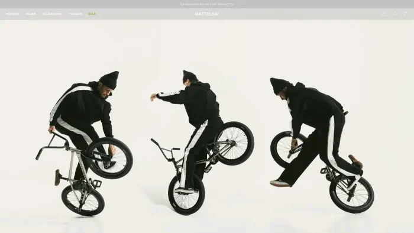
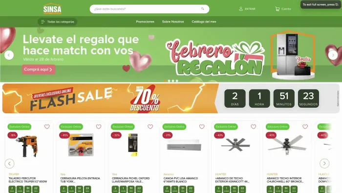
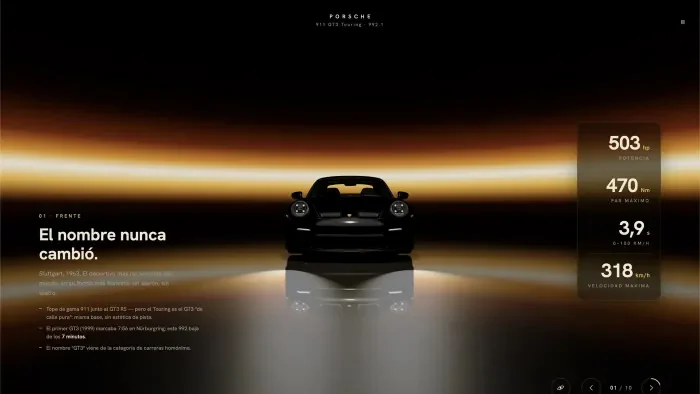

<a href="https://www.devdanielvelasco.com">
  <picture>
    <source media="(prefers-color-scheme: dark)" srcset="assets/header-dark.svg">
    
  </picture>
</a>

  
  
  

<h3>[ ABOUT ]</h3>

I'm a passionate Full-Stack Software Developer specialized in **VTEX IO**, **Shopify** and **Next.js**, with experience in international B2C and B2B e-commerce projects.

I enjoy building scalable interfaces, optimizing performance and delivering solutions that improve the user experience. My approach goes beyond writing code: I aim to create captivating, functional and high-performance digital experiences.

Bogotá, Colombia &nbsp;·&nbsp; 5+ years writing code

<h3>[ EXPERIENCE ]</h3>

**ITGlobers** — Frontend Developer MID  
2024 – Present &nbsp;·&nbsp; Bogotá, Colombia · Remote

I develop and maintain high-impact e-commerce solutions within the VTEX IO ecosystem, working closely with multidisciplinary teams to deliver scalable, performant and visually exceptional shopping experiences for international brands.

- I design and develop custom components for large-scale e-commerce stores using VTEX IO and Shopify, improving the user experience and site performance.
- I build and optimize early products and proofs of concept, combining interface development with business logic to validate new e-commerce features and flows using VTEX IO and Node.js.
- I take part in frontend architecture design for B2C and B2B platforms, working with multidisciplinary teams to estimate effort, define technical solutions and ship high-quality features on schedule.

<code>VTEX IO</code> · <code>React</code> · <code>TypeScript</code> · <code>GraphQL</code> · <code>Node.js</code> · <code>Shopify</code>

<h3>[ STACK ]</h3>

<picture>
  <source media="(prefers-color-scheme: dark)" srcset="assets/stack-dark.svg">
  
</picture>

<h3>[ SELECTED WORK ]</h3>

<table>
  <tr>
    <td width="40%" valign="top">
      
    </td>
    <td valign="top">
      <b>Mattelsa</b> 
      E-COMMERCE · B2C  
      Colombian fashion brand with a strong identity. A B2C store on VTEX with heavy storefront customization and custom components in React and TypeScript.  
      <code>VTEX IO</code> <code>React</code> <code>TypeScript</code> <code>GraphQL</code> <code>Jest</code>  
      <a href="https://www.mattelsa.net/">View live site ↗</a>
    </td>
  </tr>
  <tr>
    <td width="40%" valign="top">
      
    </td>
    <td valign="top">
      <b>Sinsa</b> 
      E-COMMERCE · B2C  
      Home improvement leader in Nicaragua. An e-commerce built from scratch on VTEX best practices with strategic storefront customizations.  
      <code>VTEX IO</code> <code>React</code> <code>TypeScript</code> <code>GraphQL</code> <code>Node.js</code>  
      <a href="https://www.sinsa.com.ni/">View live site ↗</a>
    </td>
  </tr>
  <tr>
    <td width="40%" valign="top">
      
    </td>
    <td valign="top">
      <b>911 GT3 Touring</b> 
      WEB 3D · PERSONAL  
      Interactive 3D showcase: a cinematic 10-camera tour and an automotive photo studio in WebGL. Model compressed from 17 MB to 1.7 MB.  
      <code>Three.js</code> <code>TypeScript</code> <code>GSAP</code> <code>WebGL</code>  
      <a href="https://gt3-touring-showcase.netlify.app">View live site ↗</a>
    </td>
  </tr>
</table>

<h3>[ LET'S TALK ]</h3>

Have a project in mind or just want to say hi? I'd love to hear from you.

- Portfolio: [devdanielvelasco.com](https://www.devdanielvelasco.com)
- LinkedIn: [Daniel Velasco](https://www.linkedin.com/in/daniel-velasco-a9818523a/)
- CV: [Download PDF](https://www.devdanielvelasco.com/daniel-velasco-CV.pdf)
- GitHub: [@Velasco1704](https://github.com/Velasco1704)

<picture>
  <source media="(prefers-color-scheme: dark)" srcset="assets/footer-dark.svg">
  
</picture>
