<a href="https://www.devdanielvelasco.com">
  <picture>
    <source media="(prefers-color-scheme: dark)" srcset="assets/header-dark.svg">
    
  </picture>
</a>

  
  
  
  

<h3>[ ABOUT ]</h3>

I'm a passionate Full-Stack Software Developer specialized in **VTEX IO**, **Shopify** and **Next.js**, with experience in international B2C and B2B e-commerce projects.

I enjoy building scalable interfaces, optimizing performance and delivering solutions that improve the user experience. My approach goes beyond writing code: I aim to create captivating, functional and high-performance digital experiences.

Bogotá, Colombia &nbsp;·&nbsp; 5+ years writing code

<h3>[ STACK ]</h3>

<picture>
  <source media="(prefers-color-scheme: dark)" srcset="assets/stack-dark.svg">
  
</picture>

<h3>[ LET'S TALK ]</h3>

Have a project in mind or just want to say hi? I'd love to hear from you.

- Email: [danilovelga4747@gmail.com](mailto:danilovelga4747@gmail.com)
- Portfolio: [devdanielvelasco.com](https://www.devdanielvelasco.com)
- LinkedIn: [Daniel Velasco](https://www.linkedin.com/in/daniel-velasco-a9818523a/)
- CV: [Download PDF](https://www.devdanielvelasco.com/daniel-velasco-CV.pdf)
- GitHub: [@Velasco1704](https://github.com/Velasco1704)

<picture>
  <source media="(prefers-color-scheme: dark)" srcset="assets/footer-dark.svg">
  
</picture>
